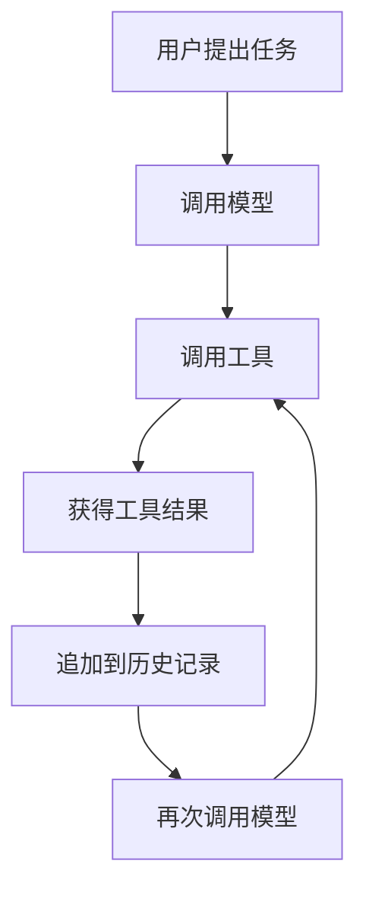
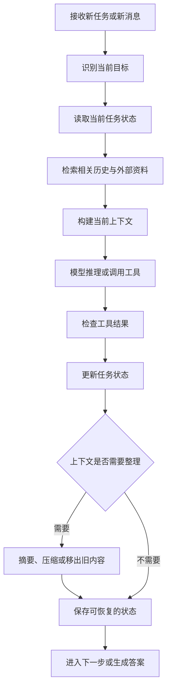

# Lecture 03 — Context Management for Long-Context Agents

> 主题：长上下文 Agent 的上下文管理  
> 课程：CMU 11-768 AI Agents  
> 笔记类型：概念整理与技术学习笔记

## 1. 核心问题：为什么 Agent 需要管理上下文？

LLM Agent 通常通过多轮推理、调用工具、读取文件和执行任务来完成工作。随着任务推进，历史对话、工具返回结果、代码和中间结论会不断累积。

上下文管理（Context Management）的目标是：在有限的上下文窗口和计算资源下，保留完成当前任务真正需要的信息。

主要挑战：

- **上下文长度有限**：模型能够处理的输入长度受上下文窗口限制。
- **计算成本增加**：长输入会增加处理时间和资源消耗。
- **信息噪声累积**：大量历史信息可能掩盖当前任务的关键信息。
- **关键信息丢失**：压缩或截断历史记录时，可能丢失约束、事实或任务进度。
- **长期任务状态复杂**：多步骤任务需要持续记录已经完成的工作、尚未解决的问题和后续行动。

## 2. Context Window 与 Attention

### 2.1 什么是 Context Window？

Context Window（上下文窗口）是模型单次处理时能够接收的上下文容量，通常以 Token 计量。

上下文可能包括：

- System Prompt 和任务指令
- 用户消息与历史对话
- 工具调用及其返回结果
- 检索到的文档
- 中间推理结果与任务状态
- 为当前回答预留的生成空间

上下文窗口越大，并不意味着 Agent 一定越聪明。系统仍然需要选择哪些信息值得保留，以及如何组织这些信息。

### 2.2 Self-Attention 的计算

Transformer 的 Scaled Dot-Product Attention 可以写为：

$$
\operatorname{Attention}(Q,K,V)
=
\operatorname{softmax}
\left(
\frac{QK^\top}{\sqrt{d_k}}
\right)V
$$

其中：

- \(Q\)：Query，查询向量
- \(K\)：Key，键向量
- \(V\)：Value，值向量
- \(d_k\)：Key 向量的维度

在标准全注意力机制下，序列长度为 \(n\) 时，注意力计算的主要复杂度通常随序列长度呈二次增长：

$$
O(n^2 d)
$$

这里的 \(d\) 表示与模型表示维度相关的规模；该表达式是简化的复杂度描述，省略了层数、注意力头等因素。

**关键理解：** 长上下文不仅意味着输入更多，还可能意味着更高的计算和内存成本。

## 3. Prefill、Decode 与 KV Cache

### 3.1 Prefill 阶段

Prefill 是模型处理输入 Prompt 的阶段。

例如，Agent 一次性读取大量历史对话或一份长文档时，模型需要处理这些输入 Token，并计算后续生成所需的中间表示。

### 3.2 Decode 阶段

Decode 是模型逐步生成输出 Token 的阶段。

在自回归生成中，模型通常根据已有上下文预测下一个 Token，然后继续生成后续 Token。

### 3.3 KV Cache

生成过程中，模型可以缓存之前 Token 的 Key 和 Value，避免每生成一个新 Token 就重新计算所有历史 Token 对应的 Key 和 Value。

优点：

- 减少重复计算
- 提高自回归生成效率

局限：

- 缓存本身需要占用显存
- 上下文越长，缓存通常越大
- 多个并发请求会增加缓存管理压力

需要区分两个概念：

- **KV Cache**：缓存模型推理过程中计算出的 Key 和 Value。
- **Prompt Caching**：复用符合条件的重复 Prompt 前缀或其相关处理结果，以减少重复处理成本。具体实现取决于模型服务平台。

两者相关，但不是同一件事。

## 4. Agent 为什么不能只依赖完整历史记录？

简单的 Agent 可以将全部历史消息不断追加到 Prompt 中：



这种方式容易实现，但随着任务变长，历史记录可能变得冗长。

例如，Agent 要分析一份包含多个文件的 Python 项目：

1. 读取项目结构。
2. 查看多个源文件。
3. 执行代码并读取日志。
4. 修复错误并再次测试。
5. 总结修改内容。

如果每轮都把所有源代码、完整日志和历史工具结果放进上下文，成本会持续增加，而且当前真正需要的信息可能被大量旧内容淹没。

因此，Agent 需要主动管理上下文，而不只是无限追加消息。

## 5. 常见的上下文管理方法

### 5.1 Summarization：摘要压缩

将较长的历史对话或执行记录压缩为更短的摘要。

例如：

原始记录：

- 第一次运行因缺少依赖失败。
- 安装依赖后，第二次运行出现字段缺失错误。
- 修复字段映射后，第三次运行通过测试。
- 最终输出保存到指定目录。

压缩后的状态：

> 已安装缺失依赖并修复字段映射；测试通过；输出文件已生成。

优点：

- 减少上下文占用
- 保留任务进度
- 适用于较长的多轮任务

风险：

- 可能丢失重要细节
- 摘要可能遗漏约束或异常信息
- 被压缩掉的信息不一定能够恢复

实践中应优先保留明确要求、关键事实、未解决问题和可验证的结果。

### 5.2 Retrieval：按需检索

不将所有历史资料一直放在上下文中，而是根据当前任务检索相关信息。

例如：

- 用户询问某个函数时，只读取相关源文件。
- 需要确认历史决策时，查询决策记录。
- 需要核实指标时，重新读取原始数据或计算结果。

优点：

- 减少无关信息
- 可以利用外部文件或知识库保存更多内容
- 重要细节可以在需要时重新获取

局限：

- 检索可能找不到相关信息
- 召回结果可能不完整
- 检索出的内容仍然需要验证

### 5.3 Truncation：截断历史

删除较早或优先级较低的内容，保留最近的上下文。

这种方法实现简单，但如果关键约束只在早期消息中出现，截断可能导致 Agent 忘记它们。

因此，截断之前最好把任务目标、重要约束和当前状态写入独立的状态记录。

### 5.4 Structured State：结构化状态

把长期任务中的重要信息保存为结构化记录，而不完全依赖自然语言对话历史。

例如：

```json
{
  "goal": "分析 Python 项目并修复测试失败",
  "completed": [
    "检查项目结构",
    "修复字段映射"
  ],
  "current_status": "部分测试通过",
  "remaining_tasks": [
    "检查边界条件",
    "重新运行完整测试"
  ],
  "constraints": [
    "保留现有接口",
    "不要覆盖原始数据"
  ]
}
```

这种方式能够让 Agent 更明确地掌握任务进度，也更容易在长任务中恢复工作。

## 6. 上下文管理的整体流程

一个实用的上下文管理流程可以表示为：



注意：这是一种通用的 Agent 设计思路，不代表所有框架都采用完全相同的执行流程。

## 7. 如何评价上下文管理是否有效？

不能仅仅用“输入 Token 变少了”来判断上下文管理是否成功。

至少需要关注以下方面：

| 评价维度 | 核心问题 |
|---|---|
| Token 成本 | 是否减少了不必要的上下文输入？ |
| 延迟 | 是否降低了处理时间？ |
| 任务成功率 | Agent 是否仍然能够完成目标？ |
| 信息保留 | 关键事实和约束是否被保留？ |
| 状态恢复 | 中断后是否能够继续执行任务？ |
| 可追溯性 | 是否能找到结论的原始依据？ |

尤其需要注意：压缩得越短，并不一定越好。如果节省了 Token，却丢失了任务约束，最终可能需要更多轮调用，甚至导致整个任务失败。

## 8. 实践案例：为代码分析 Agent 设计上下文

假设我们要构建一个能够阅读代码、运行测试并修复错误的 Agent。

可以把信息分成四类：

| 信息类型 | 建议处理方式 |
|---|---|
| 当前任务目标 | 始终保留 |
| 重要约束和用户要求 | 始终保留，必要时再次核验 |
| 当前执行状态和未完成任务 | 结构化保存并持续更新 |
| 大段旧日志、无关文件和重复输出 | 按需检索或压缩 |

一个简单的任务状态模板：

```markdown
# Task State

## Goal
修复指定模块中的测试失败。

## Constraints
- 不修改公开接口。
- 不覆盖原始数据。

## Completed
- 已检查项目结构。
- 已定位字段映射问题。

## Current Findings
- 字段映射已修复。
- 仍需检查边界条件。

## Next Steps
1. 重新运行相关测试。
2. 检查完整测试结果。
3. 记录修改文件和验证结果。

## Evidence
- 记录测试命令。
- 保存关键错误日志。
- 标明修改文件与代码位置。
```

这比单纯保留一大段对话历史更容易检查和恢复。

## 9. 本讲核心结论

1. **上下文管理是 Agent 工程中的重要问题。** 长任务需要在有限的上下文窗口和资源约束下持续工作。
2. **KV Cache 与 Prompt Caching 解决的是部分重复计算问题。** 它们不能替代对任务信息的组织与筛选。
3. **摘要、检索、截断和结构化状态各有适用场景。** 实际系统通常需要组合使用。
4. **压缩不应以牺牲任务正确性为代价。** 关键约束、证据和未完成任务应当能够被找回。
5. **评价指标应同时考虑效率与任务质量。** Token 成本降低不等于 Agent 能力提升。

## 10. 需要进一步研究的问题

- 长任务中，哪些信息应该永久保留，哪些可以删除？
- 如何判断摘要是否遗漏了关键事实？
- 如何在任务中断后恢复到正确的执行状态？
- 如何通过测试评估上下文压缩对任务成功率的影响？
- 不同的 KV Cache、注意力架构和检索机制分别解决什么问题？

## References

- [CMU 11-768 AI Agents — Course Website](https://www.cmu-agents.com/)
- [Lecture 03 — Long Context PDF](https://www.cmu-agents.com/slides/lecture-03-long-context.pdf)
- [Lecture 03 — Video](https://www.youtube.com/watch?v=AiwCCvFW1uE&list=PLSN0qpDfUvTM&index=3)

> 学习记录：本文包含通用技术解释和示例。具体哪些技术在本讲中被重点讲授，需要结合课程原始幻灯片核对。
